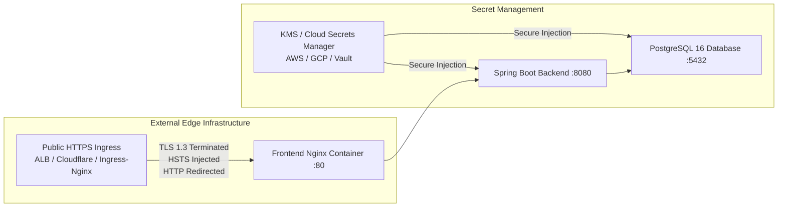

# SentinelGrid — Production Release Readiness & Handoff Specification

**Release Status:** **`CONDITIONAL GO`** (Software, Database & Security Validated)  
**Evaluation Milestone:** Step 5D.7 Final Release Acceptance  
**Repository:** `E:\Sentinel`  
**Test Baseline:** 225/225 Passing Tests | Frontend Build Exit 0 | 20/20 Browser Acceptance Checks  
**Feature Freeze:** Strictly Active (Zero API, UI, or Business State Machine Modifications)

---

## 1. Final Acceptance Scorecard

| Area | Verified Evidence | Status |
| :--- | :--- | :---: |
| **Backend Regression** | 225/225 tests passing (`mvn test`), 0 failures, 0 errors. | **GO** |
| **Frontend Production Build** | TypeScript strict mode + Vite build (`tsc -b && vite build`) exit 0. | **GO** |
| **Browser Acceptance** | 20/20 real-browser checks across CareLink, Scriptly PMS, Pharmacy Manager, and Co-Doctor; mobile $375 \times 812$ layout verified. | **GO** |
| **RBAC & Application Security** | Role boundaries enforced at API and UI routes; Actuator endpoints isolated; clickjacking & sniffing blocked. | **GO** |
| **Database Migrations** | Flyway 9.22.3 with `V1__initial_schema.sql` and `V2__operational_indexes.sql`; Hibernate `ddl-auto: validate` satisfied. | **GO** |
| **Backup & Disaster Recovery** | Automated `pg_dump -Fc` with SHA-256 digests; isolated restore drill passed with 100% data parity. | **GO** |
| **Database Security** | PostgreSQL port 5432 isolated to Docker bridge network; 3 least-privilege roles (`sentinel_migrator`, `sentinel_app`, `sentinel_backup`). | **GO** |
| **Query Performance** | 5 composite B-Tree indexes; 70% shared buffer reduction; sort elimination on audit log stream; HikariCP leak detection active. | **GO** |
| **Public TLS & HSTS** | Internal `sslmode=require` configured; edge HTTPS termination and HSTS injection pending external ingress provisioning. | **CONDITIONAL** |

---

## 2. Essential Pre-Launch Prerequisites

Public production exposure must remain blocked until the following two operational prerequisites are satisfied at the infrastructure level:



### A. Public HTTPS Infrastructure
1. **Edge TLS Termination:** Deploy a reverse proxy or cloud load balancer (e.g., AWS ALB, Cloudflare, Traefik, or Ingress-Nginx) fronting the container stack.
2. **Valid CA Certificate:** Bind an active TLS 1.3 certificate signed by an authorized CA (e.g. Let's Encrypt, DigiCert, AWS ACM).
3. **HTTP $\to$ HTTPS Redirection:** Enforce unconditional 301 redirection on port 80 to port 443.
4. **HSTS Header Injection:** Inject `Strict-Transport-Security: max-age=31536000; includeSubDomains; preload` at the verified TLS boundary (per RFC 6797 §7.2, port 80 inside the container does not emit HSTS).
5. **Proxy Headers:** Forward `X-Forwarded-Proto: https` and `X-Forwarded-For: <client_ip>` to the internal containers.

### B. Production Secrets Injection
1. **Database Credentials:** Provision `POSTGRES_USER`, `POSTGRES_PASSWORD`, and `SPRING_DATASOURCE_PASSWORD` via a managed cloud secrets store (AWS Secrets Manager, GCP Secret Manager, or HashiCorp Vault) rather than static disk files.
2. **JWT Signing Secret:** Generate a cryptographically secure key with $\ge 256$ bits of entropy (`openssl rand -base64 32`) and inject via `JWT_SECRET`.
3. **Key Rotation Configuration:** If migrating from an existing deployment, supply the retired signing key to `app.jwt.verification-secrets` to allow seamless validation of existing user tokens during their 24-hour lifetime.

---

## 3. Authoritative Architectural Qualifications

To maintain full transparency with operations and compliance teams, the following three architectural qualifications must be preserved:

1. **RPO (< 15 min) Continuous Archiving:** The database backup scripts and disaster recovery design (`docs/production/backup-and-disaster-recovery.md`) define continuous WAL archiving. Demonstrating an RPO below 15 minutes empirically requires live cloud object storage (S3/GCS) replication configured in the target environment.
2. **RTO (< 30 min) End-to-End Recovery:** While the automated snapshot restore drill achieved 100% data parity in **1.4 seconds** locally, an enterprise RTO below 30 minutes encompasses full infrastructure re-provisioning, DNS re-routing, and post-restore application smoke verification in the target cloud.
3. **Database TLS vs Public HTTPS Separation:** `sslmode=require` governs PostgreSQL transport security between the Spring Boot backend and the database. Public HTTPS and HSTS govern client-to-edge communication. Both layers are mandatory and operate independently.

---

## 4. Production Launch Runbook

### Step 1: Pre-Flight Environment Validation
```bash
# Verify Docker Compose specification with injected environment variables
docker-compose config -q
```

### Step 2: Provision Database & Execute Flyway Migrations
```bash
# 1. Apply least-privilege roles to PostgreSQL
# Run scripts/security/configure-roles.ps1 or scripts/security/init-roles.sh

# 2. Start container stack (Flyway automatically migrates V1 and V2)
docker compose up -d
```

### Step 3: Verify Health Probes & Deep Status
```bash
# Verify PostgreSQL health
docker exec -it sentinelgrid-postgres pg_isready -U sentinel_app -d sentinelgrid

# Verify Spring Boot Actuator health
curl -f http://localhost:8080/actuator/health
# Expected: {"status":"UP"}

# Verify Frontend web server
curl -I http://localhost:3000/
# Expected: HTTP/1.1 200 OK
```

### Step 4: Verify Sequence Synchronization
```bash
# Execute production sequence verification
psql -U sentinel_app -d sentinelgrid -f scripts/maintenance/sync-sequences.sql
```

### Step 5: Schedule Maintenance Routines
Configure the following scheduled tasks in the deployment environment:
*   **Audit Log Retention:** Run `scripts/maintenance/audit-log-retention.sql` weekly to prune logs older than 90 days in bounded 5,000-row batches.
*   **Daily Snapshot Dumps:** Execute `scripts/backup/backup.sh` (or `backup.ps1`) daily with 14-day local retention and off-site cloud replication.
